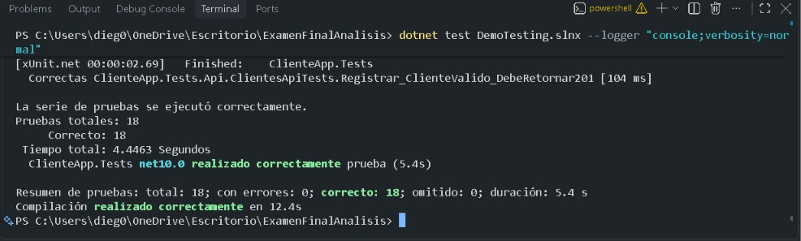

# PruebasSoftware
Ejemplos de pruebas de software: Unitarias, Integración y API

Proyecto basado en [eruanoc5/PruebasSoftware](https://github.com/eruanoc5/PruebasSoftware) (DemoTesting).

## Pruebas implementadas

| Tipo | Archivo | Prueba | Qué comprueba |
|------|---------|--------|---------------|
| Unitaria (Moq) | `ClienteApp.Tests/Unitarias/ClienteServiceTests.cs` | `ObtenerPorId_ClienteExistente_DebeRetornarClienteYConsultarRepositorioUnaVez` | `ClienteService.ObtenerPorId` devuelve el cliente esperado y consulta al repositorio una vez (`Times.Once`). |
| Integración (SQLite) | `ClienteApp.Tests/Integracion/ClienteRepositoryTests.cs` | `ObtenerPorId_IdInexistente_DebeRetornarNull` | Con el servicio y el repositorio real sobre SQLite, un identificador inexistente devuelve `null`. |
| API | `ClienteApp.Tests/Api/ClientesApiTests.cs` | `ObtenerPorId_ClienteExistente_DebeRetornar200` | `GET /api/Clientes/{id}` de un cliente existente devuelve `200 OK` (`HttpClient` + `WebApplicationFactory`). |
| API | `ClienteApp.Tests/Api/ClientesApiTests.cs` | `ObtenerPorId_ClienteInexistente_DebeRetornar404` | `GET /api/Clientes/{id}` de un cliente inexistente devuelve `404 Not Found`. |

## Ejecución

Requiere el SDK de .NET 10.

```
dotnet test DemoTesting.slnx --logger "console;verbosity=normal"
```

## Evidencia

Resultado: 18 pruebas en total, 18 correctas, 0 con errores.


